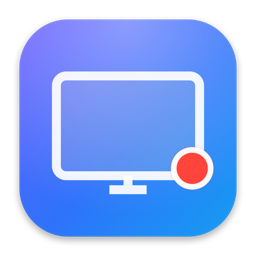
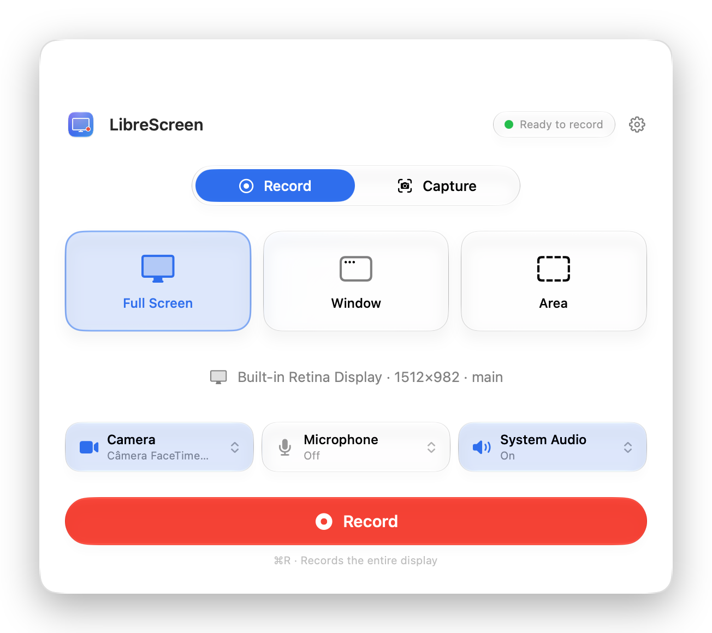
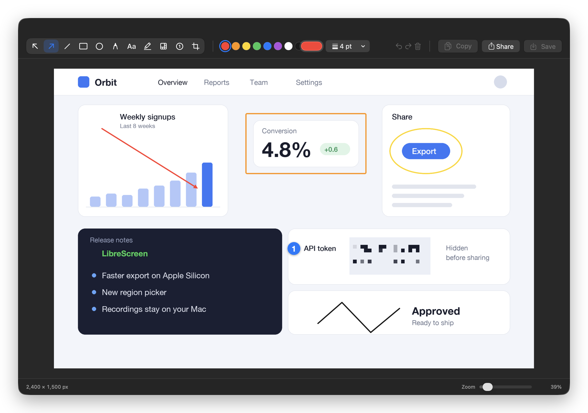
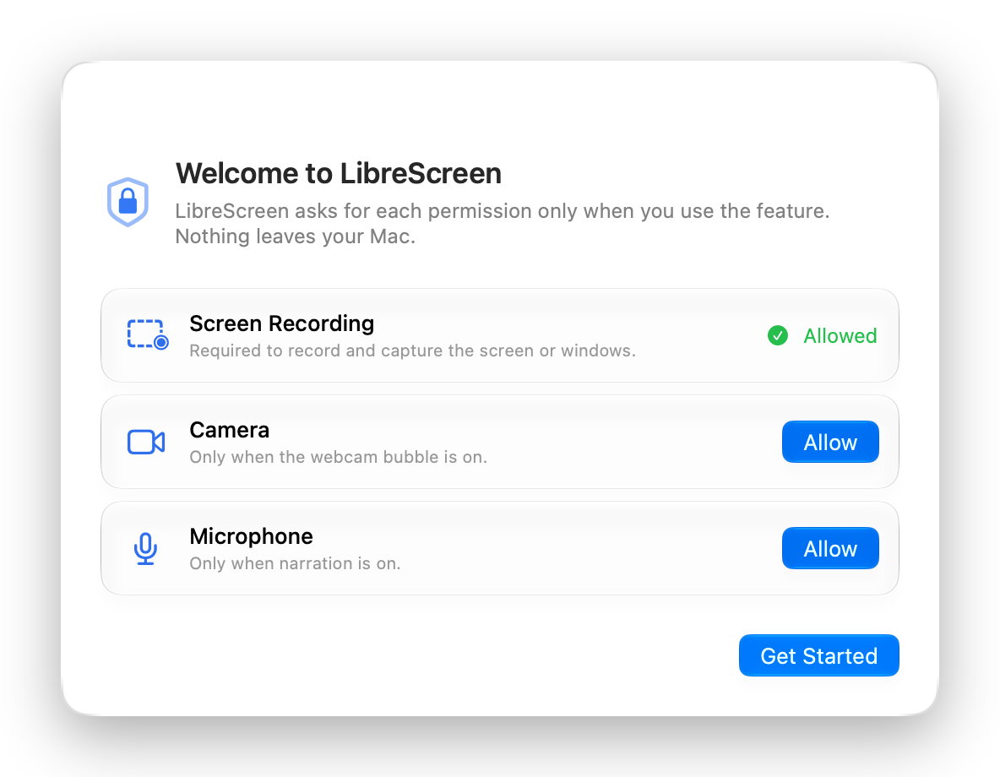
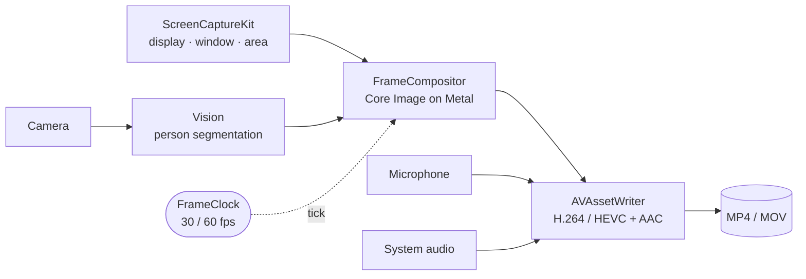

<div align="center">



# LibreScreen

**The native screen recorder for macOS — webcam bubble, annotation editor, zero telemetry.**<br />
Open source, written in Swift 6 and built for Apple Silicon.

[](https://github.com/renatoasterio/LibreScreen/actions/workflows/ci.yml)


[](LICENSE)

[Features](#features) ·
[Screenshots](#screenshots) ·
[Install](#install) ·
[Shortcuts](#keyboard-shortcuts) ·
[Privacy](#privacy-by-design) ·
[Under the hood](#under-the-hood) ·
[Contributing](#contributing) ·
[FAQ](#faq)

**English** · [Português (Brasil)](README.pt-BR.md)

<br />

<picture>
  <source media="(prefers-color-scheme: dark)" srcset="docs/assets/hub-dark.png" />
  
</picture>

</div>

## Why LibreScreen

Recording a tutorial, a bug report or a demo on a Mac usually means choosing between a tool that is too bare and a
subscription that wants an account, a cloud upload and a browser tab. LibreScreen is the small app in between.

- **You, in the recording.** The webcam bubble is composed into the video as it is recorded: one file, no editing
  afterwards, and what you see on screen is exactly what ends up in the file.
- **Nothing leaves your Mac.** No account, no upload, no analytics. The app contains no networking code at all, and CI
  fails the build if any appears.
- **It feels like macOS.** SwiftUI, a menu bar item, global shortcuts, Liquid Glass on macOS 26 with a faithful
  fallback on macOS 15.
- **Small enough to read.** About 10,000 lines of Swift, zero third-party dependencies, a documented architecture.
  You can audit what a screen recorder with camera and microphone access does before you trust it.

## Features

| Feature | What you get |
|---|---|
| 🎬 **Record** | Full display, a single window or a custom area, on any monitor. Pause and resume. H.264 or HEVC, MP4 or MOV, 30 or 60 fps, native Retina or 1× resolution, optional countdown. |
| 📹 **Webcam bubble** | Circle or rounded rectangle, three sizes, any corner, optional border and shadow, mirrored if you like. |
| 🪄 **Virtual background** | Blur the room behind you or replace it with your own image. Person segmentation runs on-device with Vision. |
| 🎙️ **Audio** | System audio and microphone, written as separate tracks so you can rebalance them later. |
| 📸 **Screenshots** | Display, window or area at full Retina resolution. PNG or JPEG, straight to the clipboard, with a floating thumbnail. |
| ✏️ **Annotation editor** | Arrows, lines, rectangles, ellipses, freehand, text, highlighter, pixelate, numbered steps and crop. Undo and redo. Copy, share or save. |
| ⌨️ **Global shortcuts** | Start, pause and stop from any app. Every shortcut is rebindable, and none needs the Accessibility permission. |
| 🌎 **Localized** | Portuguese (Brazil) and English. New languages are one String Catalog away. |

## Screenshots

<div align="center">



<em>Annotate a capture and hide what should not be shared, before it leaves the editor.</em>

<br /><br />

<picture>
  <source media="(prefers-color-scheme: dark)" srcset="docs/assets/permissions-dark.png" />
  
</picture>

<em>Permissions are requested one at a time, when you first use the feature that needs them.</em>

</div>

## Install

### Build from source

You need macOS 15 or later, an Apple Silicon Mac and Xcode 26.5 or later.

```bash
git clone https://github.com/renatoasterio/LibreScreen.git
cd LibreScreen
make tools      # one-time: xcodegen, swiftlint and swiftformat through Homebrew
make install    # Release build copied to /Applications/LibreScreen.app
```

Prefer to look around first? `make run` builds the Debug configuration and launches it, and `make help` lists every
target.

### Download

Download `LibreScreen-<version>.zip` from the
[latest release](https://github.com/renatoasterio/LibreScreen/releases/latest), unzip it and move **LibreScreen.app**
to your Applications folder. It needs macOS 15 or later and an Apple Silicon Mac.

Builds are ad-hoc signed rather than notarized, so macOS blocks a downloaded copy the first time you open it. Allow it
once in **System Settings › Privacy & Security › Open Anyway**; after that it opens normally. Apps you build yourself
need no such step.

Each release also carries a `.sha256` file, so you can check the download with
`shasum -a 256 -c LibreScreen-<version>.zip.sha256`. To be told about new versions, use
**Watch › Custom › Releases** on the repository page.

### First launch

LibreScreen asks for nothing when it starts. The first recording or capture requests **Screen Recording** (macOS needs
the app to relaunch after you grant it, and LibreScreen offers to do that for you). **Camera** and **Microphone** are
requested only when you turn those features on.

Recordings are saved to `~/Movies/LibreScreen` and screenshots to `~/Pictures/LibreScreen`. Both folders can be changed
in Settings.

## Keyboard shortcuts

| Action | Shortcut |
|---|---|
| Record full screen · window · area | <kbd>⌃</kbd><kbd>⌥</kbd><kbd>R</kbd> · <kbd>⌃</kbd><kbd>⌥</kbd><kbd>W</kbd> · <kbd>⌃</kbd><kbd>⌥</kbd><kbd>A</kbd> |
| Screenshot area · full screen · window | <kbd>⌃</kbd><kbd>⌥</kbd><kbd>S</kbd> · <kbd>⌃</kbd><kbd>⌥</kbd><kbd>⇧</kbd><kbd>S</kbd> · <kbd>⌃</kbd><kbd>⌥</kbd><kbd>⇧</kbd><kbd>W</kbd> |
| Pause or resume recording | <kbd>⌃</kbd><kbd>⌥</kbd><kbd>P</kbd> |
| Stop recording | <kbd>⌃</kbd><kbd>⌥</kbd><kbd>⎋</kbd> |

The defaults use <kbd>⌃</kbd><kbd>⌥</kbd> so they never collide with the system's <kbd>⇧</kbd><kbd>⌘</kbd>3/4/5.
Change any of them in **Settings › Shortcuts**.

## Privacy by design

A screen recorder sees everything you do. These are guarantees of the design, and breaking any of them is treated as a
security bug ([SECURITY.md](SECURITY.md)):

- **No network.** The app never opens a connection and sends no telemetry. There is no update checker either.
- **Permissions on demand.** Screen Recording, Camera and Microphone are each requested in response to the action that
  needs them, never at launch.
- **Your folders only.** Media is written atomically to the folders you choose. Temporary files are removed afterwards.
- **No helpers.** The app never spawns another process and never loads code at run time.
- **Quiet logs.** File paths, window titles and device names are logged as private values.
- **Hardened runtime**, with only the camera and audio-input entitlements.

You do not have to take that on trust:

```bash
grep -rE 'URLSession|NWConnection|import Network' LibreScreen/   # prints nothing
```

```bash
make audit   # lint, static analyzer and safety scans; CI runs the static part on every push
```

## Under the hood



A clock, not the screen stream, drives the output: ScreenCaptureKit only delivers frames when the screen changes, but
your face in the bubble has to keep moving. Each tick composes the newest screen frame and the newest camera frame on
the GPU and hands the result to a hardware encoder.

The code is split into three layers whose dependencies only point downwards:

| Layer | What lives there |
|---|---|
| **Features** | SwiftUI views and `@MainActor @Observable` view models, one folder per feature. |
| **Infrastructure** | The only layer that touches ScreenCaptureKit, AVFoundation, Vision and Core Image. |
| **Domain** | Pure models, protocols and use cases. No Apple UI or capture framework is imported here. |

- **Swift 6 language mode with strict concurrency.** Capture callbacks run on their own serial queues and the UI stays
  on the main actor.
- **Typed errors, no force unwraps.** Every failure a user can hit ends in an alert with a recovery suggestion.
- **Tested where it counts.** Domain rules, use cases and view models are covered with Swift Testing against fakes.
- **CI on every push.** Format check, strict lint, build, unit tests and the safety audit.

[docs/ARCHITECTURE.md](docs/ARCHITECTURE.md) has the full picture: threading model, recording state machine,
coordinate spaces and the manual verification checklist.

## Project status

LibreScreen is at version 0.1.0, the first public release, and you can
[download it](https://github.com/renatoasterio/LibreScreen/releases/latest) or build it yourself. The recorder, the
camera bubble, screenshots, the editor and the settings are in place, but it is a first version, so expect rough
edges. If something breaks, an
[issue](https://github.com/renatoasterio/LibreScreen/issues/new/choose) with your macOS version and Mac model is the
most useful thing you can send. Changes are tracked in [CHANGELOG.md](CHANGELOG.md).

## Contributing

Contributions are welcome, and they do not have to be code:

- **Try it and report back.** Bugs, confusing wording and anything that does not feel like a Mac app.
- **Translate it.** All text lives in one String Catalog, so adding a language is a self-contained pull request.
- **Share an idea.** Start a thread in [Discussions](https://github.com/renatoasterio/LibreScreen/discussions) before
  writing a large change.
- **Send a pull request.** [CONTRIBUTING.md](CONTRIBUTING.md) explains the setup, the ground rules and the checklist.

The repository is friendly to AI coding agents too: [CLAUDE.md](CLAUDE.md) is the working agreement and `make audit`
checks the rules it describes. Everyone taking part is expected to follow the [Code of Conduct](CODE_OF_CONDUCT.md).

If LibreScreen is useful to you, a ⭐ helps other people find it.

## FAQ

<details>
<summary><strong>Is it free? Can I use it at work?</strong></summary>

LibreScreen is free for noncommercial use: personal projects, study and research, and use by charitable, educational
and government organizations. Commercial use is not covered by the license. If you need it, open a thread in
[Discussions](https://github.com/renatoasterio/LibreScreen/discussions). This is a summary; the [LICENSE](LICENSE)
text is what applies.
</details>

<details>
<summary><strong>Is it "open source" in the OSI sense?</strong></summary>

The full source is public and you may read, build, modify and share it. The license restricts commercial use, so it
is not an OSI-approved open source license; "source-available" is the stricter term for it.
</details>

<details>
<summary><strong>Does it run on Intel Macs?</strong></summary>

No. LibreScreen is built and tested for Apple Silicon (arm64) only.
</details>

<details>
<summary><strong>Why does macOS ask me to relaunch after I allow Screen Recording?</strong></summary>

That is how macOS applies the permission: a running app only sees it after it restarts. LibreScreen offers to
relaunch itself.
</details>

<details>
<summary><strong>Do the global shortcuts need the Accessibility permission?</strong></summary>

No. They are registered through the system hot-key API, which needs no extra permission.
</details>

<details>
<summary><strong>Why is the app not notarized?</strong></summary>

Notarization requires a paid Apple Developer Program membership. Builds are ad-hoc signed for now, which is why
building from source is the recommended way to install.
</details>

## License

LibreScreen is released under the [PolyForm Noncommercial License 1.0.0](LICENSE). You may use, modify and share it for
**noncommercial purposes only**, and every copy must keep the notice:

> Required Notice: Copyright Renato Asterio (https://github.com/renatoasterio)

<div align="center">
<sub>Built by <a href="https://github.com/renatoasterio">Renato Asterio</a> and contributors.</sub>
</div>
