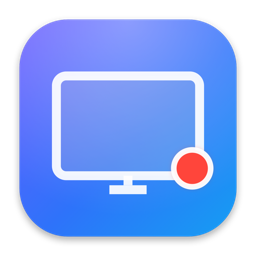
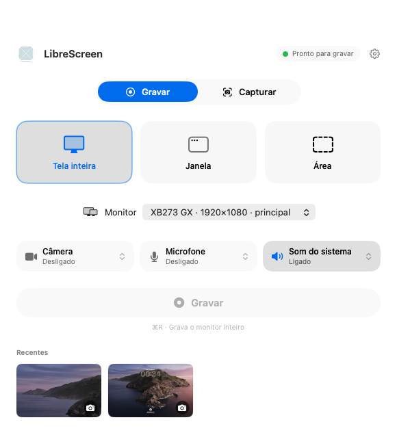

<p align="center">
  
</p>

<h1 align="center">LibreScreen</h1>

<p align="center">
  <strong>A lightweight, open-source native screen recorder for macOS built with Swift and optimized for Apple Silicon.</strong>
</p>

<p align="center">
  <a href="#features">Features</a> ·
  <a href="#requirements">Requirements</a> ·
  <a href="#building">Building</a> ·
  <a href="#architecture">Architecture</a> ·
  <a href="#license">License</a> ·
  <a href="#português">Português</a>
</p>

<p align="center">
  
</p>

---

## Features

- **Record the full display, a single window or a custom region**, with multi-monitor support.
- **Webcam overlay composed live** into a single file: circular or rounded bubble, drag it to any corner, see exactly what will be recorded.
- **Background blur or a custom background image** behind you, powered by on-device person segmentation (Vision). No cloud, no network.
- **Screen-only recording** when you don't want the camera.
- **System audio and microphone** captured as separate tracks.
- **Screenshots** of a display, window or region at full Retina resolution.
- **Annotation editor**: arrows, rectangles, ellipses, lines, freehand, text, highlighter, pixelate, numbered steps and crop, with undo/redo and export to PNG/JPEG or the clipboard.
- **Native macOS experience**: SwiftUI, menu bar quick actions, floating recording HUD, Liquid Glass on macOS 26 with a faithful fallback on macOS 15, global hotkeys, Portuguese (Brazil) and English localizations.
- **Privacy by design**: zero telemetry, zero networking, permissions requested only when you enable a feature.

## Requirements

- macOS 15 Sequoia or later (Liquid Glass UI on macOS 26 and later).
- Apple Silicon (arm64).
- Xcode 26.5 or later to build.

## Building

```bash
make tools      # one-time: xcodegen, swiftlint, swiftformat via Homebrew
make run        # Debug build and launch
make test       # unit tests
make release    # Release build, ad-hoc signed, zipped into dist/ with a SHA-256
make install    # Release build copied to /Applications
make help       # every target (lint, format, audit, smoke, snapshot, clean…)
```

Or open `LibreScreen.xcodeproj` in Xcode and press ⌘R (run `make generate` after adding files outside Xcode). The first recording asks for the Screen Recording permission; camera and microphone permissions are requested only when you turn those features on. macOS requires a relaunch after granting Screen Recording; the app offers it.

Release builds come from `make release` (or `scripts/release.sh`), which writes an ad-hoc signed `dist/LibreScreen-<version>.zip`. Because the build is not notarized, the first launch needs right-click › Open.

### Default global shortcuts

| Action | Shortcut |
|--------|----------|
| Record full screen / window / area | ⌃⌥R · ⌃⌥W · ⌃⌥A |
| Screenshot area / full screen / window | ⌃⌥S · ⌃⌥⇧S · ⌃⌥⇧W |
| Stop recording / pause or resume | ⌃⌥⎋ · ⌃⌥P |

All of them can be changed in Settings › Atalhos. In-app menu shortcuts use ⇧⌘1…6.

### Debug tooling

Debug builds accept launch arguments that make the app verifiable from a terminal without any UI interaction:

```bash
LibreScreen.app/Contents/MacOS/LibreScreen -snapshot /tmp/shots        # renders every screen to PNG
LibreScreen.app/Contents/MacOS/LibreScreen -autorecord 6                # records the main display for 6 s with a pause
LibreScreen.app/Contents/MacOS/LibreScreen -autorecord 6 -with-fake-camera   # same, with a synthetic webcam bubble
LibreScreen.app/Contents/MacOS/LibreScreen -autoscreenshot              # full-display and region screenshots
```

Run the test suite with:

```bash
xcodebuild -scheme LibreScreen test
```

Run the code audit (lint, format, static analyzer and project-specific safety checks) with:

```bash
.claude/skills/code-audit/scripts/audit.sh
```

## Architecture

LibreScreen follows MVVM with a protocol-based service layer and a composition root (`AppContainer`). The capture pipeline is built on ScreenCaptureKit, AVFoundation, Vision and Core Image on Metal. See [docs/ARCHITECTURE.md](docs/ARCHITECTURE.md) for the layer rules, threading model and frame pipeline.

## Contributing

Read [CONTRIBUTING.md](CONTRIBUTING.md) before opening a pull request. Security issues are handled as described in [SECURITY.md](SECURITY.md).

## License

LibreScreen is released under the [PolyForm Noncommercial License 1.0.0](LICENSE). You may use, modify and share it for **noncommercial purposes only**, and every copy must keep the notice:

> Required Notice: Copyright Renato Asterio (https://github.com/renatoasterio)

---

## Português

**LibreScreen** é um gravador de tela nativo para macOS, leve e de código aberto, escrito em Swift e otimizado para Apple Silicon.

- Grava a tela inteira, uma janela ou uma área, com suporte a vários monitores.
- Sobrepõe a webcam ao vivo numa bolha arrastável, com desfoque de fundo processado no próprio Mac.
- Captura áudio do sistema e microfone em trilhas separadas.
- Tira screenshots em resolução Retina e abre um editor de marcações (setas, retângulos, texto, recorte e mais).
- Interface em português do Brasil e inglês, sem telemetria e sem rede.

Licenciado sob a PolyForm Noncommercial 1.0.0: uso, modificação e distribuição permitidos **apenas para fins não comerciais**, mantendo o aviso de crédito a Renato Asterio em todas as cópias.
