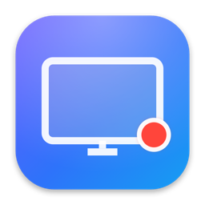
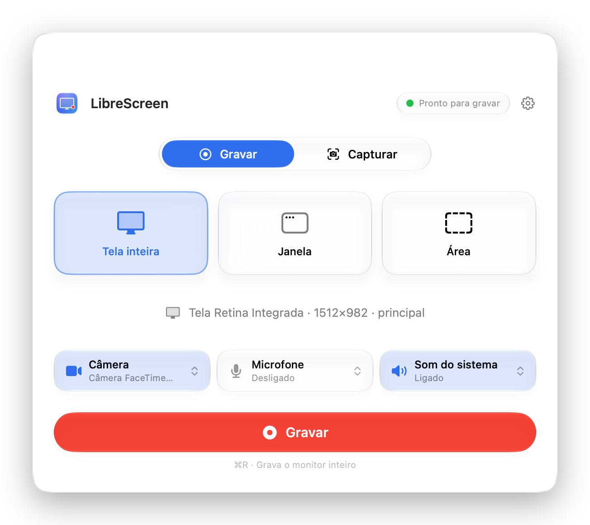
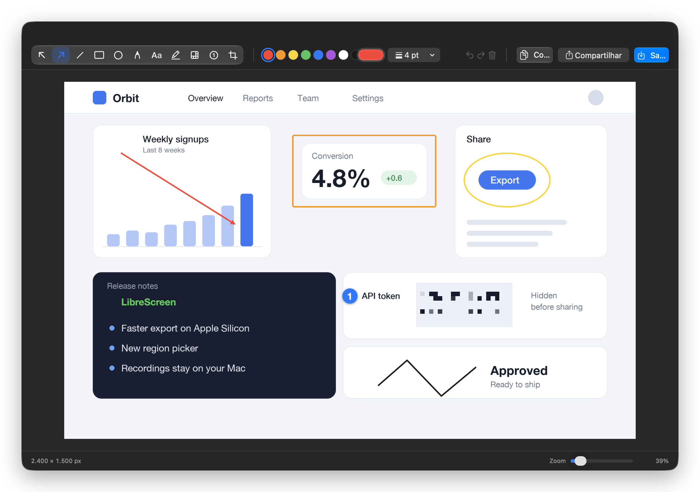
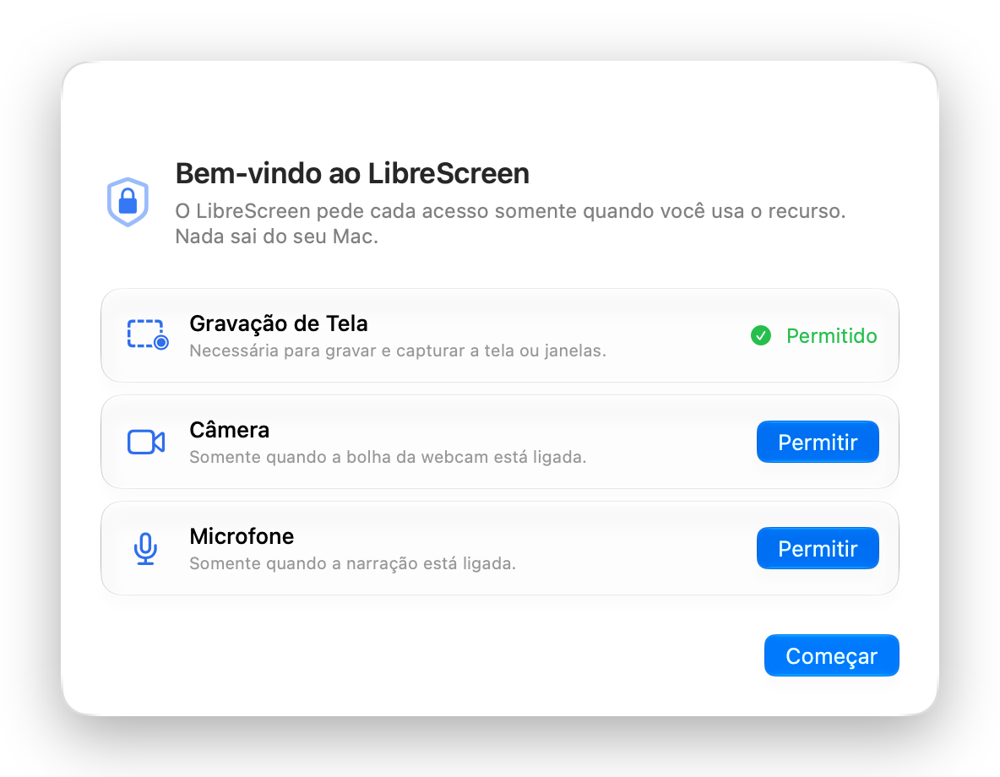
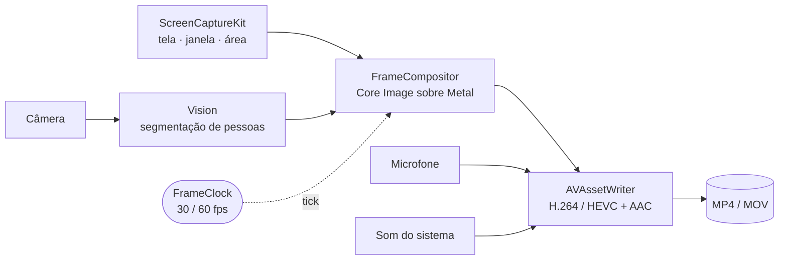

<div align="center">



# LibreScreen

**O gravador de tela nativo para macOS — bolha da webcam, editor de marcações, zero telemetria.**<br />
Código aberto, escrito em Swift 6 e feito para Apple Silicon.

[](https://github.com/renatoasterio/LibreScreen/actions/workflows/ci.yml)


[](LICENSE)

[Recursos](#recursos) ·
[Telas](#telas) ·
[Instalação](#instalação) ·
[Atalhos](#atalhos-de-teclado) ·
[Privacidade](#privacidade-desde-o-projeto) ·
[Por dentro](#por-dentro) ·
[Como contribuir](#como-contribuir) ·
[Perguntas frequentes](#perguntas-frequentes)

[English](README.md) · **Português (Brasil)**

<br />

<picture>
  <source media="(prefers-color-scheme: dark)" srcset="docs/assets/hub-dark.pt-BR.png" />
  
</picture>

</div>

## Por que o LibreScreen

Gravar um tutorial, um relato de bug ou uma demonstração no Mac costuma significar escolher entre uma ferramenta
simples demais e uma assinatura que pede conta, envio para a nuvem e uma aba do navegador. O LibreScreen é o
aplicativo pequeno que fica no meio do caminho.

- **Você dentro da gravação.** A bolha da webcam é composta no vídeo durante a gravação: um arquivo só, sem edição
  depois, e o que aparece na tela é exatamente o que vai para o arquivo.
- **Nada sai do seu Mac.** Sem conta, sem envio, sem analytics. O aplicativo não tem código de rede, e a CI quebra o
  build se algum aparecer.
- **Tem cara de macOS.** SwiftUI, item na barra de menus, atalhos globais, Liquid Glass no macOS 26 com um fallback
  fiel no macOS 15.
- **Pequeno o bastante para ler.** Cerca de 10 mil linhas de Swift, nenhuma dependência de terceiros e uma arquitetura
  documentada. Dá para auditar o que um gravador com acesso à câmera e ao microfone faz antes de confiar nele.

## Recursos

| Recurso | O que você tem |
|---|---|
| 🎬 **Gravação** | Tela inteira, uma janela ou uma área, em qualquer monitor. Pausar e retomar. H.264 ou HEVC, MP4 ou MOV, 30 ou 60 fps, resolução Retina nativa ou 1×, contagem regressiva opcional. |
| 📹 **Bolha da webcam** | Círculo ou retângulo arredondado, três tamanhos, qualquer canto, borda e sombra opcionais, espelhada se você quiser. |
| 🪄 **Fundo virtual** | Desfoque o ambiente atrás de você ou troque por uma imagem sua. A segmentação de pessoas roda no próprio Mac, com Vision. |
| 🎙️ **Áudio** | Som do sistema e microfone, gravados em trilhas separadas para você reequilibrar depois. |
| 📸 **Capturas de tela** | Monitor, janela ou área em resolução Retina. PNG ou JPEG, direto para a área de transferência, com miniatura flutuante. |
| ✏️ **Editor de marcações** | Setas, linhas, retângulos, elipses, traço livre, texto, marca-texto, pixelar, passos numerados e recorte. Desfazer e refazer. Copiar, compartilhar ou salvar. |
| ⌨️ **Atalhos globais** | Comece, pause e pare a partir de qualquer aplicativo. Todos os atalhos são configuráveis e nenhum exige a permissão de Acessibilidade. |
| 🌎 **Idiomas** | Português (Brasil) e inglês. Um novo idioma é só mais uma tradução no String Catalog. |

## Telas

<div align="center">



<em>Marque a captura e esconda o que não deve ser compartilhado, antes de ela sair do editor.</em>

<br /><br />

<picture>
  <source media="(prefers-color-scheme: dark)" srcset="docs/assets/permissions-dark.pt-BR.png" />
  
</picture>

<em>As permissões são pedidas uma de cada vez, quando você usa pela primeira vez o recurso que precisa delas.</em>

</div>

## Instalação

### Compilar a partir do código

Você precisa de macOS 15 ou posterior, um Mac com Apple Silicon e Xcode 26.5 ou posterior.

```bash
git clone https://github.com/renatoasterio/LibreScreen.git
cd LibreScreen
make tools      # uma vez só: xcodegen, swiftlint e swiftformat pelo Homebrew
make install    # build Release copiado para /Applications/LibreScreen.app
```

Quer só dar uma olhada antes? `make run` compila em Debug e abre o aplicativo, e `make help` lista todos os alvos.

### Download

Baixe o `LibreScreen-<versão>.zip` da
[versão mais recente](https://github.com/renatoasterio/LibreScreen/releases/latest), descompacte e mova o
**LibreScreen.app** para a pasta Aplicativos. Requer macOS 15 ou posterior e um Mac com Apple Silicon.

Os builds têm assinatura ad-hoc, sem notarização, então o macOS bloqueia uma cópia baixada na primeira vez que você a
abre. Libere-a uma vez em **Ajustes do Sistema › Privacidade e Segurança › Abrir Mesmo Assim**; depois disso ela abre
normalmente. Aplicativos que você mesmo compila não precisam desse passo.

Cada versão também traz um arquivo `.sha256`, para você conferir o download com
`shasum -a 256 -c LibreScreen-<versão>.zip.sha256`. Para ser avisado de novas versões, use
**Watch › Custom › Releases** na página do repositório.

### Primeira execução

O LibreScreen não pede nada ao abrir. A primeira gravação ou captura solicita **Gravação de Tela** (o macOS exige que
o aplicativo reabra depois de você permitir, e o LibreScreen se oferece para fazer isso). **Câmera** e **Microfone**
só são solicitados quando você liga esses recursos.

As gravações vão para `~/Movies/LibreScreen` e as capturas para `~/Pictures/LibreScreen`. As duas pastas podem ser
trocadas nos Ajustes.

## Atalhos de teclado

| Ação | Atalho |
|---|---|
| Gravar tela inteira · janela · área | <kbd>⌃</kbd><kbd>⌥</kbd><kbd>R</kbd> · <kbd>⌃</kbd><kbd>⌥</kbd><kbd>W</kbd> · <kbd>⌃</kbd><kbd>⌥</kbd><kbd>A</kbd> |
| Capturar área · tela inteira · janela | <kbd>⌃</kbd><kbd>⌥</kbd><kbd>S</kbd> · <kbd>⌃</kbd><kbd>⌥</kbd><kbd>⇧</kbd><kbd>S</kbd> · <kbd>⌃</kbd><kbd>⌥</kbd><kbd>⇧</kbd><kbd>W</kbd> |
| Pausar ou retomar a gravação | <kbd>⌃</kbd><kbd>⌥</kbd><kbd>P</kbd> |
| Parar a gravação | <kbd>⌃</kbd><kbd>⌥</kbd><kbd>⎋</kbd> |

Os padrões usam <kbd>⌃</kbd><kbd>⌥</kbd> para nunca colidir com os atalhos <kbd>⇧</kbd><kbd>⌘</kbd>3/4/5 do sistema.
Troque qualquer um deles em **Ajustes › Atalhos**.

## Privacidade desde o projeto

Um gravador de tela enxerga tudo o que você faz. Estas são garantias do projeto, e quebrar qualquer uma delas é
tratado como bug de segurança ([SECURITY.md](SECURITY.md)):

- **Sem rede.** O aplicativo nunca abre uma conexão e não envia telemetria. Também não há verificador de atualizações.
- **Permissões sob demanda.** Gravação de Tela, Câmera e Microfone são pedidas em resposta à ação que precisa delas,
  nunca na abertura.
- **Só nas suas pastas.** A mídia é gravada de forma atômica nas pastas que você escolhe. Arquivos temporários são
  apagados em seguida.
- **Sem processos auxiliares.** O aplicativo nunca inicia outro processo e nunca carrega código em tempo de execução.
- **Logs discretos.** Caminhos de arquivos, títulos de janelas e nomes de dispositivos são registrados como valores
  privados.
- **Hardened runtime**, apenas com os entitlements de câmera e entrada de áudio.

Você não precisa acreditar na palavra de ninguém:

```bash
grep -rE 'URLSession|NWConnection|import Network' LibreScreen/   # não imprime nada
```

```bash
make audit   # lint, analisador estático e varreduras de segurança; a CI roda a parte estática a cada push
```

## Por dentro



Quem dita o ritmo da saída é um relógio, não o stream da tela: o ScreenCaptureKit só entrega quadros quando a tela
muda, mas o seu rosto na bolha precisa continuar se mexendo. A cada tick, o quadro de tela mais recente e o quadro de
câmera mais recente são compostos na GPU e entregues a um codificador por hardware.

O código é dividido em três camadas, com dependências que só apontam para baixo:

| Camada | O que mora ali |
|---|---|
| **Features** | Views SwiftUI e view models `@MainActor @Observable`, uma pasta por recurso. |
| **Infrastructure** | A única camada que toca ScreenCaptureKit, AVFoundation, Vision e Core Image. |
| **Domain** | Modelos, protocolos e casos de uso puros. Nenhum framework de UI ou de captura da Apple é importado aqui. |

- **Swift 6 com concorrência estrita.** Os callbacks de captura rodam em filas seriais próprias e a UI fica no main
  actor.
- **Erros tipados, sem force unwrap.** Toda falha que o usuário pode encontrar termina em um alerta com sugestão de
  recuperação.
- **Testes onde importa.** Regras de domínio, casos de uso e view models são cobertos com Swift Testing usando fakes.
- **CI a cada push.** Verificação de formatação, lint estrito, build, testes unitários e auditoria de segurança.

O [docs/ARCHITECTURE.md](docs/ARCHITECTURE.md) (em inglês) traz o quadro completo: modelo de threads, máquina de
estados da gravação, espaços de coordenadas e o checklist de verificação manual.

## Estado do projeto

O LibreScreen está na versão 0.1.0, a primeira versão pública, e você pode
[baixá-la](https://github.com/renatoasterio/LibreScreen/releases/latest) ou compilar por conta própria. O gravador, a
bolha da câmera, as capturas, o editor e os ajustes estão no lugar, mas é uma primeira versão, então espere arestas.
Se algo quebrar, uma
[issue](https://github.com/renatoasterio/LibreScreen/issues/new/choose) com a versão do macOS e o modelo do Mac é a
coisa mais útil que você pode enviar. As mudanças ficam registradas no [CHANGELOG.md](CHANGELOG.md).

## Como contribuir

Contribuições são bem-vindas, e não precisam ser código:

- **Teste e conte como foi.** Bugs, textos confusos e qualquer coisa que não pareça um aplicativo de Mac.
- **Traduza.** Todo o texto mora em um único String Catalog, então um novo idioma é um pull request independente.
- **Compartilhe uma ideia.** Abra uma conversa em
  [Discussions](https://github.com/renatoasterio/LibreScreen/discussions) antes de escrever uma mudança grande.
- **Envie um pull request.** O [CONTRIBUTING.md](CONTRIBUTING.md) explica o setup, as regras e o checklist.

O repositório também é amigável a agentes de IA: o [CLAUDE.md](CLAUDE.md) é o acordo de trabalho e o `make audit`
verifica as regras que ele descreve. Quem participa segue o [Código de Conduta](CODE_OF_CONDUCT.md).

Se o LibreScreen for útil para você, uma ⭐ ajuda outras pessoas a encontrá-lo.

## Perguntas frequentes

<details>
<summary><strong>É gratuito? Posso usar no trabalho?</strong></summary>

O LibreScreen é gratuito para uso não comercial: projetos pessoais, estudo e pesquisa, e uso por organizações
beneficentes, educacionais e governamentais. O uso comercial não é coberto pela licença. Se você precisa dele, abra
uma conversa em [Discussions](https://github.com/renatoasterio/LibreScreen/discussions). Isto é um resumo; o que vale
é o texto da [LICENSE](LICENSE).
</details>

<details>
<summary><strong>É "open source" no sentido da OSI?</strong></summary>

Todo o código é público e você pode ler, compilar, modificar e compartilhar. A licença restringe o uso comercial,
portanto não é uma licença open source aprovada pela OSI; "source-available" é o termo mais rigoroso para ela.
</details>

<details>
<summary><strong>Funciona em Macs com Intel?</strong></summary>

Não. O LibreScreen é compilado e testado apenas para Apple Silicon (arm64).
</details>

<details>
<summary><strong>Por que o macOS pede para reabrir o aplicativo depois que eu permito a Gravação de Tela?</strong></summary>

É assim que o macOS aplica a permissão: um aplicativo em execução só passa a enxergá-la depois de reiniciar. O
LibreScreen se oferece para reabrir sozinho.
</details>

<details>
<summary><strong>Os atalhos globais precisam da permissão de Acessibilidade?</strong></summary>

Não. Eles são registrados pela API de hot keys do sistema, que não exige permissão extra.
</details>

<details>
<summary><strong>Por que o aplicativo não é notarizado?</strong></summary>

A notarização exige uma assinatura paga do Apple Developer Program. Por enquanto os builds têm assinatura ad-hoc, e
por isso compilar a partir do código é a forma recomendada de instalar.
</details>

## Licença

O LibreScreen é distribuído sob a [PolyForm Noncommercial License 1.0.0](LICENSE). Você pode usar, modificar e
compartilhar **apenas para fins não comerciais**, e toda cópia deve manter o aviso:

> Required Notice: Copyright Renato Asterio (https://github.com/renatoasterio)

<div align="center">
<sub>Feito por <a href="https://github.com/renatoasterio">Renato Asterio</a> e colaboradores.</sub>
</div>
